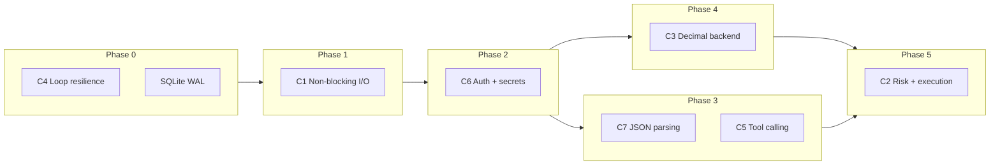
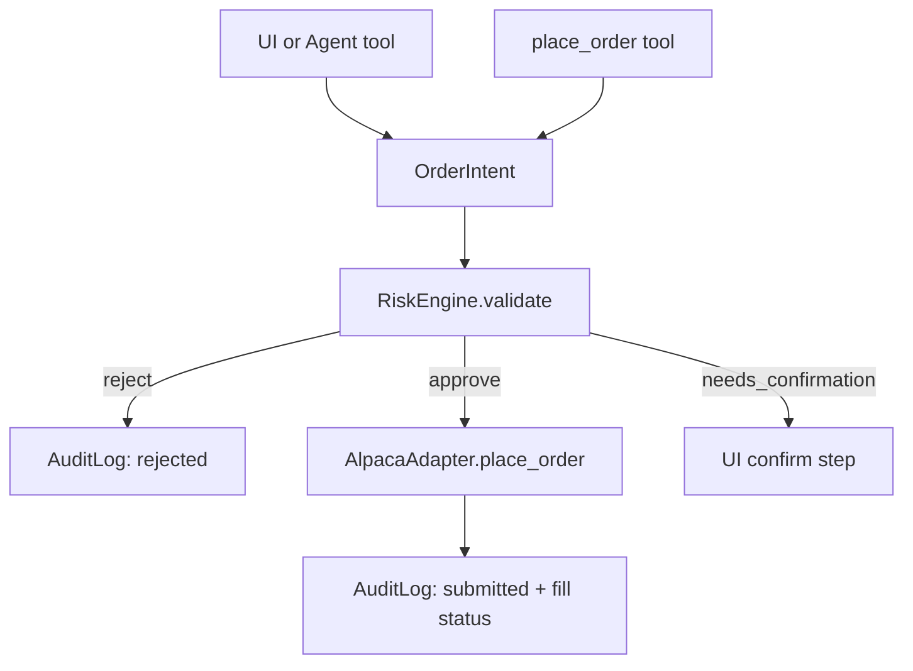

# Critical Issues Remediation Plan (C1–C8)

## Guiding principles

- **Safety before speed:** No `place_order` path exists until `RiskEngine` + audit log + API auth (C6) are in place.
- **Tests ride along:** Add pytest coverage for each area as it is touched (C8), not as a final bolt-on.
- **Incremental, shippable phases:** Each phase leaves the app runnable; prefer `asyncio.to_thread` short-term fixes before full async broker clients.



---

## Phase 0 — Stop silent failures (C4) + DB hardening

**Goal:** Background tasks never die permanently; DB contention is less likely to kill the poll loop.

### 0.1 Harden background loops

**Files:** [`api/main.py`](api/main.py)

- Wrap `_poll_loop` body in `try/except Exception` with `logger.exception`, mirroring [`ai/reflection/scheduler.py`](ai/reflection/scheduler.py).
- Apply the same pattern to `_alert_symbol_loop`.
- Inside `_poll_once`, broaden the per-broker catch to `Exception` (log + continue next broker) so one broker cannot kill the cycle.
- Track `last_successful_poll_at` (module-level or small `PollHealth` dataclass) updated only after a full successful cycle.

### 0.2 SQLite concurrency

**Files:** [`db/sqlite.py`](db/sqlite.py), [`db/ai_tables.py`](db/ai_tables.py), [`db/chart_features.py`](db/chart_features.py)

- Centralize `_connect()` in a new [`db/base.py`](db/base.py) (eliminate triplicated `ROOT`/`_connect`/`_now`).
- Add `PRAGMA journal_mode=WAL` and `PRAGMA busy_timeout=5000` on every connection.
- Atomic settings writes in [`config/settings.py`](config/settings.py): temp file + `os.replace()`, guarded by `threading.Lock`.

### 0.3 Health / staleness signal

**Files:** [`api/main.py`](api/main.py), optional frontend banner later

- Extend `GET /health` to return `last_poll_age_seconds`, `poll_healthy` (e.g. age &lt; 2× `POLL_INTERVAL_SECONDS`).
- Frontend can surface "STALE" in a follow-up PR; backend contract ships here.

### 0.4 Tests (C8 start)

- Add `pytest` to [`requirements.txt`](requirements.txt).
- Create `tests/` with `tests/test_poll_health.py` (mock `_poll_once` raising various exceptions; assert loop continues).
- Add `tests/test_db_connect.py` (WAL pragma applied).

---

## Phase 1 — Non-blocking I/O (C1)

**Goal:** Sync broker/LLM HTTP no longer freezes SSE/WebSocket on the event loop.

### 1.1 Immediate fix: thread offload (days, not weeks)

**Files:** [`api/main.py`](api/main.py), [`brokers/market_stream.py`](brokers/market_stream.py)

```python
# Pattern for _poll_once
async def _poll_broker(broker_name: str) -> None:
    def _work() -> str:
        broker = get_broker(broker_name)
        return save_snapshot(
            account=broker.get_account(),
            positions=broker.get_positions(),
            orders=broker.get_open_orders(),
            broker=broker_name,
        )
    captured_at = await asyncio.to_thread(_work)
    ...
```

- Offload entire per-broker unit in `_poll_once`; run brokers concurrently with `asyncio.gather`.
- Offload `_ensure_baselines` HTTP work: `bars_by_symbol = await asyncio.to_thread(broker.get_stock_bars_batch, missing, 12)`.
- Fix chat blocking: convert [`api/ai_routes.py`](api/ai_routes.py) `api_chat` to use `llm.astream` (true streaming) or wrap `run_chat_stream` iteration in `asyncio.to_thread` as interim.

### 1.2 Medium-term: connection reuse + settings cache

**Files:** [`brokers/alpaca.py`](brokers/alpaca.py), [`config/settings.py`](config/settings.py), [`brokers/factory.py`](brokers/factory.py)

- Hold a persistent `httpx.Client` on `AlpacaAdapter` (context manager or lifespan teardown).
- In-memory settings cache with `clear_settings_cache()` called from settings PUT (alongside existing `clear_llm_cache()`).
- Cache broker adapter instances per enabled broker name; invalidate on settings change.

### 1.3 Long-term (optional follow-up): async brokers

- Introduce `httpx.AsyncClient` + `async def get_account` etc. on `AlpacaAdapter`.
- Extend `BrokerAdapter` Protocol with async methods (or a parallel `AsyncBrokerAdapter` Protocol to avoid breaking sync scripts).
- Schwab: wrap `schwab-py` sync calls in `asyncio.to_thread` until an async client exists.

### 1.4 Tests

- `tests/test_market_stream_baselines.py`: mock broker; assert `to_thread` path does not block event loop (use `asyncio` timing assertion).

---

## Phase 2 — Security foundation (C6)

**Goal:** Local API is not wide open; secrets are not plaintext on disk.

### 2.1 API authentication

**New files:** [`api/auth.py`](api/auth.py), [`api/deps.py`](api/deps.py)

- Generate/store `API_TOKEN` in `.env` (document in [`.env.example`](.env.example)).
- FastAPI dependency `verify_api_token`: require `X-API-Token` header (or `Authorization: Bearer`) on all `/api/*` and `/ws/*` routes.
- Exempt only `GET /health` (unauthenticated liveness).
- **Host header validation:** reject requests where `Host` is not `127.0.0.1`, `localhost`, or configured bind address (DNS-rebinding defense).
- Tighten CORS in [`api/main.py`](api/main.py): replace regex with explicit `FRONTEND_ORIGIN` env var (e.g. `http://localhost:3000`).

**Frontend:** [`frontend/lib/api.ts`](frontend/lib/api.ts), WebSocket hooks — attach token header on every fetch/WS (pass via query param for WS if needed).

### 2.2 Secrets at rest

**New files:** [`config/secrets.py`](config/secrets.py)

- On Windows: use `keyring` (or `cryptography` + DPAPI) to encrypt sensitive fields before writing [`data/settings.json`](data/settings.json).
- Migration on startup: detect plaintext legacy settings, re-encrypt once, write atomically.
- Schwab token [`data/schwab_token.json`](data/schwab_token.json): encrypt file contents or move refresh token into keyring; update [`brokers/schwab_auth.py`](brokers/schwab_auth.py).
- `SECRET_KEYS` in [`config/settings.py`](config/settings.py) remain the canonical list; encrypt/decrypt at `load_settings`/`save_settings` boundary only.
- Set restrictive file permissions where OS supports it.

### 2.3 Tests

- `tests/test_auth.py`: missing/wrong token → 401; valid token passes; bad Host → 403.
- `tests/test_secrets.py`: round-trip encrypt/decrypt; legacy plaintext migration.

---

## Phase 3 — LLM reliability (C7 + C5)

These can proceed in parallel after Phase 2 auth is in place (research endpoints will be protected).

### 3.1 Centralized JSON parsing (C7)

**New file:** [`ai/llm/structured.py`](ai/llm/structured.py)

- Implement `parse_json_object(raw: str) -> dict | None` with: fence stripping, balanced-brace extraction (not `rfind`), optional Pydantic `model_validate` wrapper `parse_structured(raw, Model) -> Model | None`.
- Add retry helper: on parse failure, one re-prompt with "return valid JSON only" (configurable, off in tests).
- Enable provider JSON mode per task:
  - OpenAI-compat: `response_format={"type": "json_object"}` in [`ai/llm/openai_compat.py`](ai/llm/openai_compat.py)
  - Ollama: `format: "json"` in [`ai/llm/ollama.py`](ai/llm/ollama.py)
  - Anthropic: tool-use or structured output where supported

**Replace copy-paste in:**
- [`ai/research/deep_graph.py`](ai/research/deep_graph.py) (`_plan_queries`, `_extract_findings`, `_evaluate_gaps`)
- [`ai/research/report.py`](ai/research/report.py)
- [`ai/chat/memory_extract.py`](ai/chat/memory_extract.py)
- [`ai/reflection/service.py`](ai/reflection/service.py)

- Surface parse failures to logs and optionally to API response metadata (not silent empty arrays).

### 3.2 Real tool calling (C5)

**Files:** [`ai/chat/tools.py`](ai/chat/tools.py), [`ai/chat/agent.py`](ai/chat/agent.py), LLM providers

- Remove keyword `plan_tools()` as the primary planner.
- Define tools with JSON schemas (`get_portfolio_snapshot`, `search_memories`, `start_research` — not `run_research` inline).
- Implement async tool loop: model → tool_calls → execute → feed results → model (max N rounds).
- **Research is never synchronous in chat:** `start_research` enqueues a background job; chat returns job ID; client uses existing [`POST /api/research/stream`](api/ai_routes.py) for progress.
- Remove `"analyze"` as a blind trigger; model must explicitly call `start_research`.
- Fix symbol extraction: consolidate [`ai/chat/tools.py`](ai/chat/tools.py) and [`ai/research/sources.py`](ai/research/sources.py) into [`ai/utils/symbols.py`](ai/utils/symbols.py) with stopword list + optional snapshot validation.
- Set low temperature (0–0.3) for extraction tasks; higher only for creative report synthesis.

### 3.3 Research job manager

**New file:** [`ai/research/jobs.py`](ai/research/jobs.py)

- Registry of in-flight tasks with max concurrency (e.g. 2), per-run timeout, cancellation.
- Convert [`POST /api/research/run`](api/ai_routes.py) to enqueue rather than block thread pool.

### 3.4 Tests

- `tests/test_structured.py`: nested JSON, trailing prose, markdown fences, malformed input.
- `tests/test_tools.py`: mock LLM returning tool_calls; assert research is not invoked without explicit call.
- `tests/test_symbol_extract.py`: USA/CEO/AI false positives rejected.

---

## Phase 4 — Decimal money types, backend only (C3)

**Goal:** Financial values are exact in Python and SQLite; JSON serializes as strings; frontend keeps `number` (parsed from strings at boundary).

### 4.1 Domain models

**Files:** [`brokers/base.py`](brokers/base.py)

- Change `Account`, `Position`, `Order`, `StockBar`, `PortfolioHistoryPoint` monetary/qty fields to `Decimal`.
- Add small helpers: `money(value) -> Decimal`, `qty(value) -> Decimal` with consistent quantization rules (document: 2 dp for USD, broker qty precision per asset class later).

### 4.2 Broker parse boundary

**Files:** [`brokers/alpaca.py`](brokers/alpaca.py), [`brokers/schwab.py`](brokers/schwab.py)

- Parse API strings directly into `Decimal` (never `float()`).
- Schwab: dedupe `_account_payload()` so account + positions share one HTTP round-trip (also helps C1).

### 4.3 Persistence + API serialization

**Files:** [`db/sqlite.py`](db/sqlite.py), snapshot save/load, [`ai/rules/engine.py`](ai/rules/engine.py), [`api/alert_checker.py`](api/alert_checker.py), [`brokers/market_stream.py`](brokers/market_stream.py)

- Store money/qty as `TEXT` in SQLite (migration: `ALTER` new columns or rebuild tables with `schema_version` bump).
- JSON API responses: serialize `Decimal` as strings via custom encoder in a shared [`api/serialize.py`](api/serialize.py).
- Rules engine: use `Decimal` arithmetic for sums/comparisons.
- Frontend [`frontend/lib/api.ts`](frontend/lib/api.ts): `parseFloat` on string fields at fetch time (acceptable per your scope choice); no `decimal.js` yet.

### 4.4 Tests

- `tests/fixtures/alpaca_account.json`, `schwab_positions.json`
- `tests/test_broker_parsing.py`: canned JSON → expected `Decimal` values
- `tests/test_rules_engine.py`: operator logic with `Decimal` facts
- `tests/test_alert_checker.py`: `_crossed` boundary cases (`prev == target`, etc.)

---

## Phase 5 — Risk engine + execution (C2)

**Goal:** Full stack — `OrderIntent` → `RiskEngine.validate()` → Alpaca `place_order`/`cancel_order` → audit log. Every order path goes through the gate; no bypass.



### 5.1 Core types and persistence

**New package:** `trading/`

| Module | Responsibility |
|--------|----------------|
| [`trading/intent.py`](trading/intent.py) | `OrderIntent` (symbol, side, qty, type, limit_price, source: human/agent) |
| [`trading/risk.py`](trading/risk.py) | `RiskEngine`, `RiskDecision` (approve/reject/needs_confirmation), configurable limits |
| [`trading/audit.py`](trading/audit.py) | Append-only `audit_log` table + `record()` |
| [`trading/service.py`](trading/service.py) | `ExecutionService.submit(intent)` — sole entry point |

**Risk checks (v1):**
- `trading_mode`: `"paper"` \| `"live"` — default paper; live requires typed confirmation stored in settings
- Max order notional / % of equity
- Max position concentration per symbol
- Daily loss limit / drawdown kill-switch (from snapshot P&amp;L)
- Max orders per minute (in-memory sliding window)
- Symbol allowlist / blocklist
- Market-hours check (Alpaca clock API)
- Refuse live orders unless `trading_mode == "live"`

### 5.2 Broker adapter extension

**Files:** [`brokers/base.py`](brokers/base.py), [`brokers/alpaca.py`](brokers/alpaca.py)

- Add `place_order(intent) -> Order`, `cancel_order(order_id) -> None` to Protocol.
- Implement on Alpaca only initially; Schwab raises `NotImplementedError`.
- `ExecutionService` is the **only** caller of `place_order` — not routes, not agent tools directly.

### 5.3 API + agent integration

**New router:** [`api/trading_routes.py`](api/trading_routes.py)

- `POST /api/orders` — body validated with Pydantic; calls `ExecutionService.submit`
- `DELETE /api/orders/{id}` — cancel through service
- `GET /api/audit-log` — paginated history
- Agent tool `place_order` in [`ai/chat/tools.py`](ai/chat/tools.py) calls `ExecutionService` (never broker directly); requires explicit user confirmation flow for agent-initiated orders (`needs_confirmation`).

**Settings:** add `trading_mode`, risk limit fields to [`config/settings.py`](config/settings.py) + settings UI.

### 5.4 Tests

- `tests/test_risk_engine.py`: each guardrail with table-driven cases
- `tests/test_execution_service.py`: mock broker; assert audit entries for approve/reject
- `tests/test_trading_api.py`: auth + risk rejection paths
- Integration test with Alpaca paper API behind env flag (optional, skipped in CI)

---

## Phase 6 — Test infrastructure completion (C8)

**Goal:** Financial logic is protected by fast unit tests; smoke scripts remain for E2E.

### 6.1 Test layout

```
tests/
  conftest.py          # fixtures: temp DB, mock settings, MockLLM
  fixtures/            # canned broker JSON
  test_rules_engine.py
  test_settings.py     # merge, mask, secret preservation, encrypt round-trip
  test_broker_parsing.py
  test_alert_checker.py
  test_structured.py
  test_risk_engine.py
  test_auth.py
```

### 6.2 Settings tests (high value)

**File:** [`config/settings.py`](config/settings.py) — `_deep_merge`, `apply_settings_patch`, `mask_settings`, watchlist normalization.

### 6.3 CI

**New file:** `.github/workflows/ci.yml`

- `ruff check`, `pytest -q`, optional `mypy` on `brokers/`, `trading/`, `ai/rules/`
- Keep [`scripts/test_ai_stack.py`](scripts/test_ai_stack.py) as manual/nightly E2E

---

## Recommended execution order (summary)

| Step | Issues | Effort | Key deliverable |
|------|--------|--------|-----------------|
| 1 | C4 + DB | XS–S | Loops never die; WAL; health staleness |
| 2 | C1 (thread offload) | S | Poll + baselines + chat off event loop |
| 3 | C6 | S | API token + Host check + encrypted secrets |
| 4 | C7 | S | `parse_json_object` + JSON mode + tests |
| 5 | C8 (core) | S | pytest + rules/settings/broker/alert tests |
| 6 | C5 | M | Real tool calling + async research jobs |
| 7 | C3 | M | Decimal backend + DB TEXT + string JSON |
| 8 | C2 | L | RiskEngine + Alpaca execution + audit log |
| 9 | C1 (async clients) | M | Optional polish: httpx.AsyncClient |
| 10 | C8 (CI) | S | GitHub Actions |

**Estimated total:** ~3–5 weeks for one developer, with Phases 0–3 shippable in the first week.

---

## Out of scope (but noted in review)

- Schwab order execution (Alpaca only in Phase 5)
- Frontend `decimal.js` migration
- Full Alembic migrations (lightweight `schema_version` table is enough for Decimal + audit_log)
- Mem0/SQLite memory reconciliation
- Legacy HTML dashboard removal

## Success criteria

- Under load, SSE/WS clients remain responsive during broker polls (C1).
- Poll loop survives injected DB/parse failures; `/health` reports stale data (C4).
- All API routes reject unauthenticated requests; secrets encrypted at rest (C6).
- Chat does not auto-run deep research on the word "analyze" (C5).
- Structured LLM outputs use shared parser + JSON mode; failures are logged (C7).
- Broker snapshots and rules use `Decimal`; no `float` in [`brokers/base.py`](brokers/base.py) (C3).
- `POST /api/orders` cannot bypass `RiskEngine`; audit log records every intent (C2).
- `pytest` covers rules, settings, broker parsing, alerts, JSON parser, risk engine (C8).
