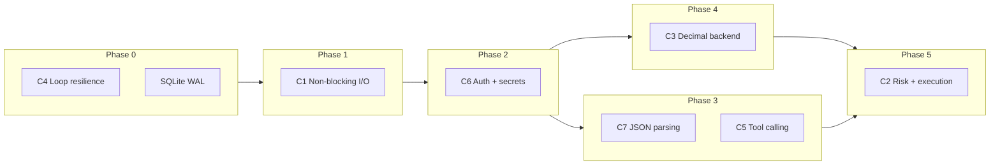

# Platform Hardening — Master Plan

**Purpose:** Single authoritative document merging the [comprehensive code review](ai-trading-platform-code-review.md) (diagnosis, severity, rationale) with the [critical issues remediation plan](../.cursor/plans/critical_issues_remediation_2d726a14.plan.md) (phased implementation, files, tests).

**Merge rules:**
- **Review** is source of truth for *what* to fix, *why*, and *priority*.
- **Remediation plan** is source of truth for *how* to implement C1–C8 (phases, file paths, success criteria).
- Where they agree (all C1–C8), there is no technical conflict — only depth and ordering differences.
- Items outside C1–C8 live in **§5 Post-Critical Backlog** so nothing is lost.

---

## 1. Executive Summary

### What's genuinely good (keep building on this)

- Clean layering: `brokers/` → `db/` → `ai/` → `api/`
- `BrokerAdapter` Protocol with frozen dataclasses — proven by Schwab slotting in
- Provider-agnostic LLM layer with `MockLLM` default
- Secrets masked on API surface; `.env` gitignored; preserve-secret merge on settings PATCH
- Real streaming infrastructure (SSE + shared upstream WebSocket hub)
- Tracer-bullet, incremental build discipline

### Critical issues (C1–C8)

| # | Issue | Risk | Primary phase |
|---|--------|------|---------------|
| **C1** | Blocking sync `httpx` on the async event loop (`_poll_once`, baselines, insight stream) | Freezes all SSE/WebSocket clients on every poll | Phase 1 |
| **C2** | No risk-management or execution layer | Runaway loss, fat-finger, hallucinated orders when trading ships | Phase 5 |
| **C3** | Money is `float` everywhere | Rounding/precision errors — unacceptable for live trading | Phase 4 |
| **C4** | Poll loop dies permanently on non-`BrokerError` exceptions | Silent stale data; rules stop evaluating | Phase 0 |
| **C5** | Keyword "tool use"; "analyze" can trigger full sync research | Unpredictable latency, cost, behavior | Phase 3 |
| **C6** | Plaintext secrets on disk; zero API authentication | Local process or DNS-rebinding can read portfolio / change settings | Phase 2 |
| **C7** | Fragile `find('{')…rfind('}')` JSON parsing; no schema validation | Silent empty findings, bad rules, lost memories | Phase 3 |
| **C8** | Near-zero unit test coverage on financial logic | Regressions unnoticed until they cost money | Phases 0–6 |

### Guiding principles

1. **Safety before speed** — No `place_order` until `RiskEngine` + audit log + API auth (C6) exist.
2. **Tests ride along** — Add pytest coverage per phase (C8), not as a final bolt-on.
3. **Incremental, shippable phases** — Each phase leaves the app runnable.
4. **Staged I/O fix** — `asyncio.to_thread` now (C1); `httpx.AsyncClient` + `gather` later (optional polish).



---

## 2. Priority Spine (P0–P3)

Ordered by do-this-first value. Impact weighs financial-loss / reliability risk heavily.

| Priority | Item | Issues | Effort | Phase |
|----------|------|--------|--------|-------|
| **P0** | Wrap background loops in try/except so polling can't die silently | C4 | XS | 0 |
| **P0** | Move blocking broker/LLM I/O off event loop (`to_thread` now; async clients later) | C1 | S–M | 1 |
| **P0** | SQLite WAL + busy timeout; atomic settings writes + lock | C4-adjacent | S | 0 |
| **P0** | Minimal API auth + Host-header check + tighten CORS | C6 | S | 2 |
| **P1** | Design RiskEngine + audit log + paper/live gating **before** any `place_order` | C2 | M–L | 5 (design starts after Phase 2) |
| **P1** | Rule trigger debounce + deliver portfolio alerts to UI | — | S–M | Post-critical |
| **P1** | Switch money fields to `Decimal` (start at broker parse boundary) | C3 | M | 4 |
| **P1** | pytest for rules, settings merge, alert crossing, broker parsing | C8 | M | 0–6 |
| **P2** | Real LLM tool-calling; `run_research` as async cancellable job | C5 | M–L | 3 |
| **P2** | True token streaming for chat via `astream` | C1-adjacent | S–M | 1 |
| **P2** | Centralize JSON parsing; provider JSON mode; low temperature | C7 | S | 3 |
| **P2** | Cache settings in-memory; reuse httpx clients | C1-adjacent | S | 1 |
| **P2** | Encrypt secrets at rest; SSRF guard on `fetch_url` | C6 / — | S–M | 2 / Post-critical |
| **P3** | Pydantic request models; split `api/main.py` into routers | — | M | Post-critical |
| **P3** | Versioned migrations; remove per-call `init_*()` | — | M | Post-critical |
| **P3** | Market-hours polling; remove legacy HTML; structured logging | — | S | Post-critical |
| **P3** | Reconcile Mem0/SQLite memory + embeddings search | — | M | Post-critical |

**Dependency note:** Decimal (Phase 4) must complete before live order execution (Phase 5). Auth (Phase 2) must complete before protected research/trading endpoints.

---

## 3. Critical Issues — Rationale + Implementation

### C4 — Background loop resilience + DB hardening

**Why (review §3.1, §3.2):** `_poll_once` only catches `BrokerError`. A `sqlite3.OperationalError` or rule-engine exception kills `_poll_loop` forever. Data goes stale silently. SQLite defaults (no WAL, no busy timeout) make "database is locked" likely under concurrent writes. Settings writes are non-atomic.

**Phase 0 implementation:**

| Task | Files |
|------|-------|
| Wrap `_poll_loop` / `_alert_symbol_loop` in `try/except Exception` + `logger.exception` | `api/main.py` |
| Per-broker catch in `_poll_once` (log + continue) | `api/main.py` |
| Track `last_successful_poll_at`; extend `GET /health` with `last_poll_age_seconds`, `poll_healthy` | `api/main.py` |
| Centralize `_connect()` in `db/base.py`; WAL + `busy_timeout=5000` | `db/base.py`, `db/sqlite.py`, `db/ai_tables.py`, `db/chart_features.py` |
| Atomic settings: temp file + `os.replace()`, `threading.Lock` | `config/settings.py` |

**Tests:** `tests/test_poll_health.py`, `tests/test_db_connect.py`

**Success:** Poll loop survives injected DB/parse failures; `/health` reports stale data.

---

### C1 — Non-blocking I/O on the event loop

**Why (review §2.1, §2.2):** `_poll_once`, `market_stream._ensure_baselines`, and `_stream_insight` call sync `httpx` on the event loop. Every SSE/WebSocket client stalls. `get_broker()` re-reads settings from disk and opens fresh TCP connections per call.

**Phase 1 implementation:**

| Task | Files |
|------|-------|
| **Use the wrapped `_work()` pattern** — offload entire per-broker unit via `asyncio.to_thread`; poll brokers with `asyncio.gather` | `api/main.py` |
| Offload `_ensure_baselines` bar fetches | `brokers/market_stream.py` |
| True chat streaming via `llm.astream`, or interim `to_thread` wrapper | `api/ai_routes.py`, `ai/chat/agent.py` |
| Persistent `httpx.Client` on `AlpacaAdapter` | `brokers/alpaca.py` |
| In-memory settings cache + `clear_settings_cache()` on PUT | `config/settings.py`, `brokers/factory.py` |
| Cache broker adapter instances; invalidate on settings change | `brokers/factory.py` |

**Long-term (optional):** `httpx.AsyncClient` + async broker methods; Schwab via `to_thread` until async client exists.

```python
# Correct pattern (not the minimal broken snippet)
async def _poll_broker(broker_name: str) -> None:
    def _work() -> str:
        broker = get_broker(broker_name)
        return save_snapshot(
            account=broker.get_account(),
            positions=broker.get_positions(),
            orders=broker.get_open_orders(),
            broker=broker_name,
        )
    captured_at = await asyncio.to_thread(_work)
```

**Tests:** `tests/test_market_stream_baselines.py` (timing assertion that event loop isn't blocked)

**Success:** SSE/WS clients stay responsive during broker polls.

---

### C6 — Authentication and secrets at rest

**Why (review §7.1, §7.2, §4.2):** No API auth — any local process or DNS-rebinding attack can read portfolio and overwrite credentials. Secrets in `data/settings.json` and `data/schwab_token.json` are plaintext. Paper vs live is only an `api_base_url` string — no explicit mode flag.

**Phase 2 implementation:**

| Task | Files |
|------|-------|
| `API_TOKEN` in `.env`; `verify_api_token` dependency on `/api/*` and `/ws/*` | `api/auth.py`, `api/deps.py`, `.env.example` |
| Exempt only `GET /health` | `api/main.py` |
| Host header validation (127.0.0.1, localhost, bind address) | `api/auth.py` |
| Tighten CORS to explicit `FRONTEND_ORIGIN` | `api/main.py` |
| Frontend attaches `X-API-Token` on fetch/WS | `frontend/lib/api.ts`, WS hooks |
| Encrypt secrets at rest (keyring / DPAPI on Windows) | `config/secrets.py` |
| Encrypt/decrypt at `load_settings`/`save_settings` boundary; legacy plaintext migration | `config/settings.py` |
| Schwab refresh token encryption | `brokers/schwab_auth.py` |

**`trading_mode` (paper | live):** Enforced in RiskEngine (Phase 5); add setting + UI red banner in post-critical §5.

**Tests:** `tests/test_auth.py`, `tests/test_secrets.py`

**Success:** Unauthenticated requests rejected; secrets encrypted at rest.

---

### C7 + C5 — LLM reliability (JSON parsing + tool orchestration)

**Why (review §5.1, §5.3, §5.5):**
- Keyword `plan_tools()` — typing "analyze my risk" triggers full sync deep-research; `extract_symbol` false-positives (USA, CEO, AI).
- `find('{')…rfind('}')` copy-pasted 5×; no schema validation; no retries.
- No temperature control; large tool_results JSON blows context on local models.

**Phase 3 implementation:**

**C7 — Centralized JSON parsing**

| Task | Files |
|------|-------|
| `parse_json_object()` — fence strip, balanced-brace extraction (not `rfind`) | `ai/llm/structured.py` |
| Optional Pydantic `parse_structured(raw, Model)` + one retry re-prompt | `ai/llm/structured.py` |
| Provider JSON mode per task | `ai/llm/openai_compat.py`, `ai/llm/ollama.py`, `ai/llm/anthropic.py` |
| Replace copy-paste in research, memory extract, reflection | `ai/research/deep_graph.py`, `ai/research/report.py`, `ai/chat/memory_extract.py`, `ai/reflection/service.py` |
| Low temperature (0–0.3) for extraction tasks | LLM provider configs |

**C5 — Real tool calling**

| Task | Files |
|------|-------|
| Remove keyword `plan_tools()` as primary planner | `ai/chat/tools.py` |
| JSON-schema tools; async tool loop (model → tool_calls → result → model) | `ai/chat/agent.py`, LLM providers |
| `start_research` enqueues job — never sync `run_research` in chat | `ai/chat/tools.py`, `ai/research/jobs.py` |
| Job registry: max concurrency, timeout, cancellation | `ai/research/jobs.py` |
| Convert `POST /api/research/run` to enqueue | `api/ai_routes.py` |
| Consolidate symbol extraction | `ai/utils/symbols.py` |

**Tests:** `tests/test_structured.py`, `tests/test_tools.py`, `tests/test_symbol_extract.py`

**Success:** Chat does not auto-run deep research on "analyze"; structured outputs use shared parser; failures logged.

---

### C3 — Decimal money types (backend)

**Why (review §2.3):** `float` cannot represent `0.1` exactly; P&L sums accumulate error; `qty * price` disagrees with broker books.

**Phase 4 implementation:**

| Task | Files |
|------|-------|
| `Decimal` on `Account`, `Position`, `Order`, `StockBar`, etc. | `brokers/base.py` |
| Parse broker API strings directly into `Decimal` (never `float()`) | `brokers/alpaca.py`, `brokers/schwab.py` |
| Schwab: dedupe `_account_payload()` (also helps C1) | `brokers/schwab.py` |
| Store money/qty as `TEXT` in SQLite | `db/sqlite.py` |
| Serialize `Decimal` as strings in JSON API | `api/serialize.py` |
| Rules engine + alert checker use `Decimal` arithmetic | `ai/rules/engine.py`, `api/alert_checker.py` |
| Frontend `parseFloat` at fetch boundary (no `decimal.js` yet) | `frontend/lib/api.ts` |

**Tests:** `tests/fixtures/`, `tests/test_broker_parsing.py`, `tests/test_rules_engine.py`, `tests/test_alert_checker.py`

**Success:** No `float` in `brokers/base.py`; broker snapshots and rules use `Decimal`.

---

### C2 — Risk engine + execution

**Why (review §4.1, §4.2, §7.4, §10 #1):** No `place_order`, no `RiskEngine`, no audit trail. **Do not add `place_order` to the adapter and wire it to a button.** Design the safety layer first. Every order — human or AI — must pass the same gate. No bypass path.

**Split for planning:**

| Track | Scope |
|-------|-------|
| **C2 foundation (required)** | `OrderIntent`, `RiskEngine`, `AuditLog`, `trading_mode`, paper/live gating |
| **C2 feature (optional epic)** | UI order ticket, agent `place_order` tool, Alpaca live execution |

**Phase 5 implementation:**

```
Agent/UI → OrderIntent → RiskEngine.validate() → [approve / reject / needs_confirmation]
                              │
                              ├─ trading_mode paper vs live
                              ├─ max order notional / % equity
                              ├─ max position concentration
                              ├─ daily loss / drawdown kill-switch
                              ├─ max orders per minute
                              ├─ symbol allowlist / blocklist
                              └─ market-hours check
                          → BrokerAdapter.place_order()  (only if approved)
                          → AuditLog.record(intent, decision, result)
```

| Module | Responsibility |
|--------|----------------|
| `trading/intent.py` | `OrderIntent` (symbol, side, qty, type, limit_price, source) |
| `trading/risk.py` | `RiskEngine`, `RiskDecision` |
| `trading/audit.py` | Append-only `audit_log` table |
| `trading/service.py` | `ExecutionService.submit()` — **sole** entry point |

| Task | Files |
|------|-------|
| Add `place_order` / `cancel_order` to Protocol; Alpaca only | `brokers/base.py`, `brokers/alpaca.py` |
| `ExecutionService` is the only caller of `place_order` | `trading/service.py` |
| API routes behind auth | `api/trading_routes.py` |
| Agent tool calls `ExecutionService` (never broker directly); `needs_confirmation` for agent orders | `ai/chat/tools.py` |
| Risk limit fields + `trading_mode` in settings | `config/settings.py` + settings UI |

**Tests:** `tests/test_risk_engine.py`, `tests/test_execution_service.py`, `tests/test_trading_api.py`; optional Alpaca paper integration (skipped in CI)

**Success:** `POST /api/orders` cannot bypass `RiskEngine`; audit log records every intent.

---

### C8 — Test coverage + CI

**Why (review §8.1):** Only smoke scripts exist. Rules engine, settings merge, broker parsing, alert crossing, and JSON parser have zero coverage.

**Implementation (spread across phases, completed in Phase 6):**

```
tests/
  conftest.py          # temp DB, mock settings, MockLLM
  fixtures/            # canned broker JSON
  test_poll_health.py
  test_db_connect.py
  test_auth.py
  test_secrets.py
  test_structured.py
  test_tools.py
  test_symbol_extract.py
  test_broker_parsing.py
  test_rules_engine.py
  test_alert_checker.py
  test_settings.py     # merge, mask, secret preservation
  test_risk_engine.py
  test_execution_service.py
  test_trading_api.py
```

| Task | Files |
|------|-------|
| Add `pytest` to requirements | `requirements.txt` |
| GitHub Actions: `ruff check`, `pytest -q`, optional `mypy` | `.github/workflows/ci.yml` |
| Keep smoke scripts for E2E | `scripts/test_ai_stack.py`, `scripts/test_ai_provider.py` |

**Success:** Fast unit tests protect financial logic; CI runs on every push.

---

## 4. Execution Order Summary

| Step | Phase | Issues | Effort | Key deliverable |
|------|-------|--------|--------|-----------------|
| 1 | 0 | C4 + DB | XS–S | Loops never die; WAL; health staleness |
| 2 | 1 | C1 (thread offload) | S | Poll + baselines + chat off event loop |
| 3 | 2 | C6 | S | API token + Host check + encrypted secrets |
| 4 | 3 | C7 | S | `parse_json_object` + JSON mode + tests |
| 5 | 0–6 | C8 (core) | S | pytest + rules/settings/broker/alert tests |
| 6 | 3 | C5 | M | Real tool calling + async research jobs |
| 7 | 4 | C3 | M | Decimal backend + DB TEXT + string JSON |
| 8 | 5 | C2 | L | RiskEngine + Alpaca execution + audit log |
| 9 | 1 | C1 (async clients) | M | Optional: `httpx.AsyncClient` |
| 10 | 6 | C8 (CI) | S | GitHub Actions |

**Estimated total:** ~3–5 weeks for one developer. Phases 0–3 shippable in the first week.

---

## 5. Post-Critical Backlog

Items from the review **not** in C1–C8. Same priority labels as §2.

### P1 — Do soon after P0

| Item | Why | Key files / approach |
|------|-----|----------------------|
| **Rule debounce + UI delivery** | Rules fire every 20s while condition holds → DB bloat, alert fatigue; portfolio rules never reach frontend | `ai/rules/engine.py` — state-transition / cooldown; wire to WebSocket like price alerts |
| **Data freshness + mode banner** | Silently stale data is a correctness bug on a trading screen | Frontend banner: "last updated Xs ago / STALE", "PAPER vs LIVE" |

### P2 — Before agent autonomy

| Item | Why | Key files / approach |
|------|-----|----------------------|
| **True chat streaming** | `complete()` then fake typewriter — user waits on spinner | `ai/chat/agent.py` — async + `astream` |
| **SSRF guard on `fetch_url`** | Web search can redirect to loopback / metadata IPs | `ai/research/sources.py` — block private IPs, cap redirects, size limit |
| **Prompt injection hygiene** | Fetched web content steers model; worse once agent trades | Delimited DATA sections; never authorize actions from fetched content |
| **Research concurrency limits** | Sync deep runs exhaust thread pool | Covered in Phase 3 `jobs.py`; verify timeout + cancel |

### P3 — Hygiene and scale

| Item | Why | Key files / approach |
|------|-----|----------------------|
| **Pydantic request bodies** | Hand-validated `dict` bodies, no OpenAPI schema | All `api/*` routes |
| **Split `api/main.py`** | 600-line god module | `routers/watchlists.py`, `routers/market.py`, etc. |
| **Versioned migrations** | `init_*()` on every DB call; silent `ALTER` failures | `schema_version` table or Alembic-lite |
| **Remove legacy HTML dashboard** | Duplicates Next.js at `/` | `api/main.py` lines 527–611 |
| **Market-hours-aware polling** | 24/7 broker hits when markets closed | `api/main.py` poll loop |
| **Structured logging + observability** | `basicConfig` never called; no request IDs / metrics | Startup config; per-LLM-call telemetry; `AgentRun` wrapper (§10 #4) |
| **Mem0/SQLite reconciliation** | Dual-write drift; keyword `LIKE` isn't semantic | Pick one source of truth + embedding index |

### Product roadmap (review §10)

1. **Backtesting / paper-replay harness** — historical bars, deterministic evaluation, metrics before autonomous trading
2. **Rules as strategy-learning substrate** — reflection proposes rule changes; track hit-rate and outcome
3. **Unified `AgentRun` abstraction** — cost/latency telemetry across insights, research, reflection
4. **P&L module** — realized vs unrealized, fees, cost-basis (not `sum(float(...))`)

---

## 6. Explicitly Out of Scope (for C1–C8 phases)

- Schwab order execution (Alpaca only in Phase 5)
- Frontend `decimal.js` migration
- Full Alembic migrations (lightweight `schema_version` is enough for Decimal + audit_log)
- Mem0/SQLite reconciliation (post-critical P3)
- Legacy HTML dashboard removal (post-critical P3)

---

## 7. Global Success Criteria

- [ ] Under load, SSE/WS clients remain responsive during broker polls (**C1**)
- [ ] Poll loop survives injected failures; `/health` reports stale data (**C4**)
- [ ] All API routes reject unauthenticated requests; secrets encrypted at rest (**C6**)
- [ ] Chat does not auto-run deep research on the word "analyze" (**C5**)
- [ ] Structured LLM outputs use shared parser + JSON mode; failures logged (**C7**)
- [ ] Broker snapshots and rules use `Decimal`; no `float` in `brokers/base.py` (**C3**)
- [ ] `POST /api/orders` cannot bypass `RiskEngine`; audit log records every intent (**C2**)
- [ ] `pytest` covers rules, settings, broker parsing, alerts, JSON parser, risk engine (**C8**)

---

## 8. Document Provenance

| Source | Role |
|--------|------|
| `References/ai-trading-platform-code-review.md` | Diagnosis, severity, architecture rationale, P0–P3 roadmap, post-critical findings |
| `.cursor/plans/critical_issues_remediation_2d726a14.plan.md` | Phased implementation detail, file paths, tests, mermaid flows |

**Conflict resolution:** For C1–C8, both documents agree on technical direction. Where the review showed a weaker C1 code snippet (`to_thread` around `save_snapshot` with sync args still inside), use the wrapped `_work()` pattern from the remediation plan. Where the remediation plan bundled full trading execution into C2, this document splits **foundation** (required) from **feature epic** (optional UI/agent orders).

---

*Start with Phase 0 — loop resilience, WAL, and health staleness are small, high-impact changes that can ship immediately.*
