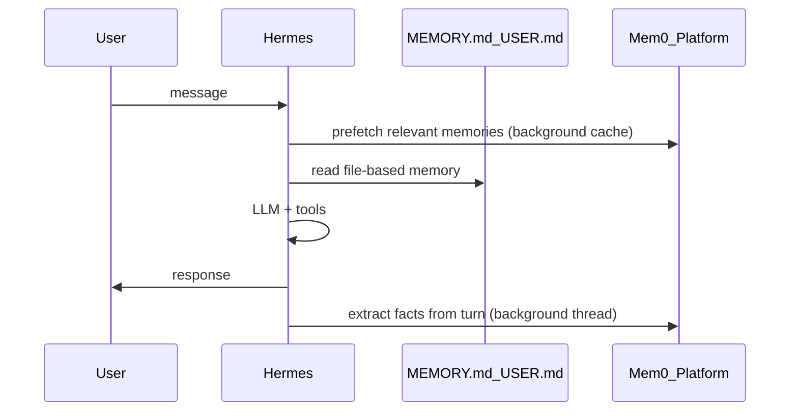
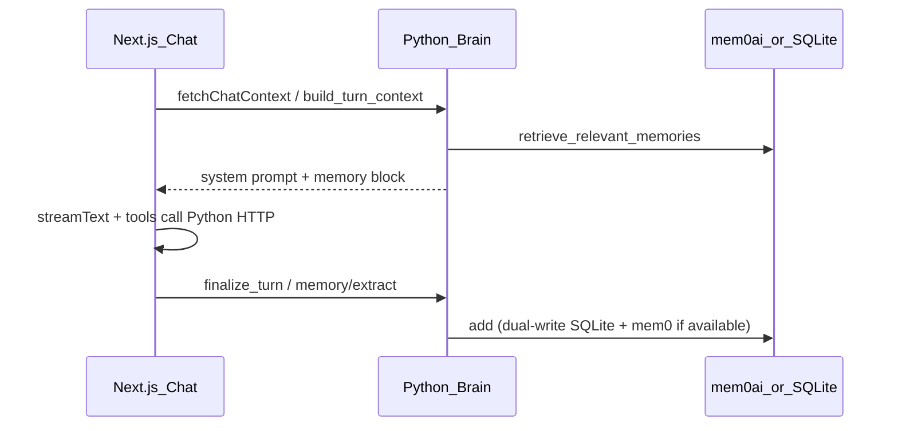

# Hermes Agent vs Help Me Trade (Mem0 + LangGraph)

Comparison of **Nous Research’s [Hermes Agent](https://github.com/NousResearch/hermes-agent)** with this project’s **mem0 + LangGraph** setup.

**Hermes Agent** is a standalone autonomous agent harness — CLI/TUI, skills, sub-agents, cron, MCP, messaging bots. **Help Me Trade** is a domain-specific trading copilot app with Python as the brain and Next.js as the chat host. They overlap on Mem0 *ideas*, but architecture and scope differ significantly.

---

## At a glance

| | **Hermes Agent** | **Help Me Trade (ours)** |
|---|---|---|
| **What it is** | General-purpose agent runtime you deploy (VPS, Modal, etc.) | FastAPI + Next.js app with trading UI |
| **Chat host** | Hermes owns the full loop (CLI/gateway) | Next.js `app/api/chat/route.ts` (AI SDK `streamText`) |
| **“Brain”** | Same process — tools + memory + LLM together | **Python** via HTTP (`/api/context`, tools, research) |
| **LangGraph** | Not the core model (skills/tools/sub-agents instead) | **Research only** — `ai/research/deep_graph.py` |
| **Mem0** | Optional **cloud** provider (`MEM0_API_KEY`); one of 8 plugins | **Self-hosted** `mem0ai` in Python + SQLite mirror |
| **Autonomy** | Designed to run 24/7, self-improve skills, delegate | User-driven chat; no autonomous trading |
| **Domain** | Anything (coding, ops, trading *if you build skills*) | Portfolio, performance, broker sync, rules |

---

## Memory: similar loop, different ownership

### Hermes + Mem0

From [Mem0’s Hermes integration](https://docs.mem0.ai/integrations/hermes):

- Built-in **file memory** (`MEMORY.md`, `USER.md`) always on
- Mem0 is **additive** — semantic search, server-side fact extraction, `mem0_profile` / `mem0_search` / `mem0_conclude` tools
- Typically **hosted Mem0 API** (third party can hold conversation-derived facts)

### Help Me Trade (mem0 pattern, Python-backed)

Per `References/BUILD.md` §2:

**Key code paths:**

- `ai/chat/context.py` — `turn_memory_context()` injects memories every turn
- `ai/memories/__init__.py` — `MemoryService` mirrors SQLite + optional self-hosted `mem0ai`
- `ai/chat/memory_extract.py` — extract memories after saved-mode turns

### Differences that matter

| Topic | Hermes | Help Me Trade |
|-------|--------|---------------|
| Mem0 location | Often **cloud** | **Local** `mem0ai` only (reject Mem0 cloud in Node) |
| Dual store | Built-in files + one external provider | SQLite + optional mem0 (known drift risk) |
| Extraction | Mem0 server LLM extracts facts | `memory_extract.py` (LLM + heuristics) |
| Injection | Prefetch every turn | `turn_memory_context` on chat/insights/research |
| Privacy | Conversations can leave your machine (if cloud Mem0) | Stays on your machine / your Python API |

We aim for the **same mem0 demo loop** (extract → store → retrieve → inject) that [assistant-ui’s mem0 example](https://www.assistant-ui.com/examples/mem0) shows, but **backed by Python**, not Hermes’s harness.

---

## LangGraph: Hermes doesn’t use it the way we do

**Hermes** orchestrates via **skills**, tool loops, sub-agents, and cron — not a LangGraph state machine in the app sense.

**Help Me Trade** uses LangGraph for **deep research only**:

- `ai/research/deep_graph.py` — plan → collect → analyze → loop → synthesize
- Triggered by `start_research` as an **async job**, not inline in every chat turn

**Chat** is simpler:

1. `plan_tools(user_text)` — JSON planner picks tools
2. `execute_tool()` — portfolio, memories, research job, trade history, performance
3. One `llm.complete()` with tool results in the prompt

No LangGraph checkpoints, interrupts, or resumable multi-step chat graph. `References/BUILD.md` locks **rejecting** the assistant-ui **LangGraph stockbroker runtime** for chat; borrow only the Approve/Reject UI pattern later (Phase 3–4).

---

## Agent loop: autonomy vs copilot

### Hermes is built to

- Run continuously (cron, gateway, Telegram, etc.)
- **Learn skills** from experience and refine them
- Spawn **sub-agents** for parallel work
- Search its own past conversations
- Operate as a **general agent OS**

### Help Me Trade is built to

- Ground answers in **real broker data** (ledger, snapshots, FIFO performance)
- Gate anything dangerous behind **RiskEngine** (Phase 4) — Hermes has no opinion on that
- Keep **secrets and execution in Python**; Node only streams chat and proxies tools
- Use research as an **async job**, not inline in every chat turn

**Chat split today:**

- Next.js: `frontend/app/api/chat/route.ts` — AI SDK `streamText`, fetches context/runtime from Python
- Python: `ai/chat/brain.py`, `ai/chat/agent.py`, `ai/chat/tools.py` — brain, tools, memory finalize

---

## When Hermes would vs wouldn’t fit

**Hermes makes sense if** you want a personal agent that lives outside the app — monitors markets on a schedule, messages you on Telegram, evolves its own “skills,” and uses Mem0 cloud for long-term user modeling.

**Our stack makes sense if** you want a **trading product** with:

- Real Schwab/Alpaca integration and a performance page
- Auditable, gated order flow
- Research and memory **inside your data boundary**
- A web UI, not primarily a CLI agent

You could run Hermes *alongside* Help Me Trade (Hermes skills that call FastAPI), but that would be a second agent runtime — not a replacement for the mem0 + LangGraph layout.

---

## Practical takeaway

| Layer | Hermes | Help Me Trade |
|-------|--------|---------------|
| **Memory pattern** | Mem0 integration is mature and turnkey | Same *pattern*, self-hosted; tightening dual-store + semantic retrieval |
| **Orchestration** | Skills + sub-agents + cron | Chat = AI SDK tool loop; research = LangGraph job |
| **UI** | CLI/TUI/bots | Next.js (+ planned assistant-ui) |
| **Trading** | You’d build custom skills | First-class ledger, performance, sync, future RiskEngine |

**Hermes is an agent platform; Help Me Trade is a trading copilot that borrows Mem0’s memory loop and LangGraph for research, but not Hermes’s runtime.**

`References/BUILD.md` takes assistant-ui’s **mem0** and **stockbroker** examples as *patterns* (Python memory, approval cards) without adopting Hermes or the LangGraph chat runtime.

---

## Related docs in this repo

| Doc | Purpose |
|-----|---------|
| [References/BUILD.md](../References/BUILD.md) | Full roadmap; assistant-ui / mem0 / stockbroker decisions (§2) |
| [AGENTS.md](../AGENTS.md) | Agent onboarding brief |
| [References/archive/chat-copilot-deep-dive-and-rebuild-plan.md](../References/archive/chat-copilot-deep-dive-and-rebuild-plan.md) | Historical chat architecture notes |

---

*Exported 2026-06-16 from agent conversation.*
